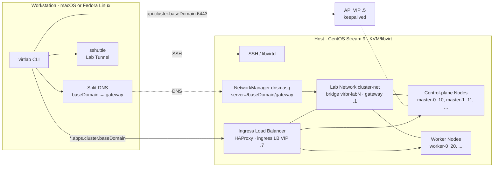

# Lab architecture

Reference material, not a procedure. This document describes the lab topology
and the resource ownership. The procedures are in
[`runbooks/README.md`](runbooks/README.md). The formal domain terms are in
[`UBIQUITOUS-LANGUAGE.md`](UBIQUITOUS-LANGUAGE.md). The configuration schema is
in [`configuration.md`](configuration.md). Runtime state is explained in
[`state.md`](state.md).

`virtlab` runs on the Workstation. It drives one remote Host over SSH. The Host
runs KVM/libvirt and hosts the Guest VMs of one OpenShift cluster. The design
supports one active lab at a time: the Workstation lock and the Host conflict
check stop a second lab while one is active.

## Topology

```text
Workstation (macOS or Fedora Linux)
  virtlab CLI
    ├── split-DNS: <baseDomain> → Lab Gateway
    └── sshuttle Lab Tunnel: Lab Network CIDR + targeted DNS → Host

Host (CentOS Stream 9, KVM/libvirt)
  NetworkManager dnsmasq
    └── server=/<baseDomain>/<gateway>

  Lab Network <cluster>-net, bridge virbr-labN, gateway <cidr>.1
    ├── libvirt dnsmasq: cluster DNS and DHCP
    ├── Ingress Load Balancer (compact/ha): HAProxy on the Ingress LB VIP
    └── Guest VMs: master-N, worker-N
          └── OpenShift cluster
                api.<cluster>.<baseDomain>:6443
                console-openshift-console.apps.<cluster>.<baseDomain>
```



The diagram shows `compact` and `ha`. In `sno` there is one Guest, no VIP, and
no HAProxy. `api`, `api-int`, and `*.apps` all resolve to that Guest's lease.

The bridge name is not fixed. `virtlab` reuses the bridge of an existing Lab
Network. Otherwise it selects the lowest free `virbr-labN`, starting at
`virbr-lab0`.

## Addressing

Every address comes from the resolved Lab Network CIDR. `virtlab` derives the
defaults by offset.

| Name | Default offset | Published as | Present in |
|---|---|---|---|
| Gateway | `.1` | — | all presets |
| API VIP | `.5` | `api`, `api-int` | `compact`, `ha` |
| Ingress VIP | `.6` | — (reserved by `platform: baremetal`) | `compact`, `ha` |
| Ingress LB VIP | `.7` | `*.apps.<cluster>.<baseDomain>` | `compact`, `ha` |
| Control-plane leases | `.10` and up | `<node>.<cluster>.<baseDomain>` | all presets |
| Worker leases | `.20` and up | `<node>.<cluster>.<baseDomain>` | `ha` |
| DHCP pool | `.100`–`.200` | — | all presets |

The API VIP is held by keepalived on the Control Plane Nodes. The Ingress VIP
is required by the installer but is not used by external clients. The Ingress
LB VIP belongs to the Host-side HAProxy.

For the override rules and validation, see
[`configuration.md`](configuration.md#network).

## Resource ownership

### Pulumi-owned resources

`virtlab` uses the Pulumi Automation API with an inline program. The Pulumi
project is always `virtlab`. The stack is named after `clusterName`. By default
the state uses the local file backend under the operator's home directory.

The stack also records the Host it was applied to (`libvirt:uri`) and the
backend that owns it (`virtlab:backend`). `virtlab up` and `virtlab down` stop
on a mismatch instead of rewriting the record. This keeps state bound to the
Host that holds the resources. The state stores and backup procedure are in
[`state.md`](state.md#backup-and-restore).

| Resource | Package | Key values |
|---|---|---|
| Lab Pool | `internal/infrastructure` (`storagepool.go`) | pool `<cluster>`, type `dir`, path `/home/libvirt/<cluster>/pool`, autostart and build enabled |
| Lab Network and bridge | `internal/infrastructure` (`network.go`) | network `<cluster>-net`, bridge `virbr-labN`, forward mode `nat`, DNS domain `<baseDomain>` with `localOnly`, gateway `<cidr>.1`, DHCP range `.100`–`.200`, static leases `master-N` → `.10+`, `worker-N` → `.20+` |
| Guest VMs and disks | `internal/infrastructure` (`guest.go`) | domains `<cluster>-<node>`, volumes `<cluster>-<node>.qcow2`, KVM with `host-passthrough`, serial log `/home/libvirt/<cluster>/logs/<node>-serial.log`, created powered off |

The Lab Network DNS contains:

- `api` and `api-int`, which resolve to the API VIP in `compact`/`ha`, or to the
  single node in `sno`;
- the FQDN and short name of every node;
- `*.apps`, which resolves to the Ingress LB VIP in `compact`/`ha`, or to the
  node in `sno`.

If `network.cidr` is unset, `virtlab` reuses the subnet of an existing Lab
Network. Otherwise it allocates the lowest free `192.168.X.0/24`, starting at
`X=100`.

### Host-owned resources outside Pulumi

These resources are plain files and system settings. `virtlab` finds them again
by `clusterName` convention, not by a state file.

| Resource | Package | Key values |
|---|---|---|
| Host base preparation | `internal/host` (`prepare.go`) | installs `libvirt`, `qemu-kvm`, `dnsmasq`, `chrony`, `haproxy`, and the other base packages; enables `libvirtd` and `chronyd`; sets `net.ipv4.ip_forward=1`; creates the cluster directories |
| Host DNS bridge | `internal/host` (`prepare.go`) | NetworkManager dnsmasq forwarding zone `server=/<baseDomain>/<gateway>` |
| OpenShift toolchain | `internal/host` (`tools.go`) | installs `openshift-install` and `oc` that match `ocpVersion` and the Host architecture |
| Pull secret | `internal/host` (`pullsecret.go`) | `/root/pull-secret.json`, mode `0600` |
| VRRP readiness | `internal/host` (`multicast.go`) | IGMP snooping set to `0` on the Lab Network bridge, so VRRP multicast reaches every Guest |
| Ingress Load Balancer | `internal/host` (`ingresslb.go`) | HAProxy in TCP mode on ports `80` and `443`, `balance source`, `tcp-check`; config `/etc/virtlab/<cluster>-haproxy.cfg`; unit `virtlab-<cluster>-haproxy.service`; PID and socket under `/run`; VIP on the bridge; ports opened in the `libvirt` firewalld zone |
| Cluster bootstrap | `internal/cluster` (`openshift.go`, `platform.go`) | `install-config.yaml` and `agent-config.yaml`, Agent ISO, attach and boot, `install-complete`, ISO eject, router replica reconciliation |
| Cluster tree | `internal/config` | `/home/libvirt/<cluster>` with `pool/`, `installer/`, and `logs/` |

In `compact`, the Ingress Load Balancer fronts the three schedulable Control
Plane Nodes. In `ha`, it fronts the two Worker Nodes. `virtlab` reconciles the
default `IngressController` to one router on each ingress Node: 3 replicas in
`compact`, 2 in `ha`. `sno` has no Ingress Load Balancer and skips this step.

### Workstation-owned resources

| Resource | Package | Key values |
|---|---|---|
| Tool dependencies | `internal/workstation` (`dependencies.go`) | installs `sshuttle`, `pulumi`, and `ocm` when missing; tracks them in state |
| Split-DNS | `internal/workstation` (`splitdns.go`) | macOS `/etc/resolver/<baseDomain>`; Fedora `/etc/systemd/resolved.conf.d/lab-<cluster>.conf` |
| Lab Tunnel | `internal/workstation` (`tunnel.go`) | `sshuttle --ns-hosts=<gateway> --to-ns=<gateway>:53 -r <user>@<host> <cidr>` |
| State and credentials | `internal/workstation` (`state.go`), `internal/verification` (`verify.go`) | `state.json`, `sshuttle.pid`, `virtlab.lock`; `~/.kube/config.<cluster>` and `~/.kube/kubeadmin-password.<cluster>` |

Phase 4 verification requires `oc` on the Workstation. `virtlab` does not
install it.

## Lifecycle

`virtlab up` runs preflight checks, then four phases.

| Stage | Actions |
|---|---|
| Preflight | Load and validate `config.yaml`; verify user tools and install managed tools; resolve the pull secret; check Workstation state and Host connectivity; reject a co-existing lab; reject an immutable platform change; check Host capacity; resolve the CIDR, gateway, and VIPs; reject a declaration mismatch on a healthy cluster; at the start of Phase 2, reject live Host resources that no Pulumi stack tracks, and reject a stack bound to another Host or backend |
| Phase 1: Preparation | Prepare the Host base; install the pinned `openshift-install` and `oc`; deliver the pull secret to the Host |
| Phase 2: Lab setup | Resolve the bridge; run Pulumi to create the pool, network, and Guest VMs; in `compact`/`ha`, disable IGMP snooping, assign the Ingress LB VIP to the bridge, and start HAProxy |
| Phase 3: Installation | Render the installer manifests; build the Agent ISO; attach the ISO and boot every Guest; wait for `install-complete`; eject and remove the ISO; reconcile the `IngressController` replicas |
| Phase 4: Verification | Configure split-DNS and start the Lab Tunnel; check DNS answers; probe the API `/healthz`; probe the web console; sync the kubeconfig and kubeadmin password; run `oc get nodes` and require every node to be `Ready` |

Phase 3 has a resume guard. If the installer kubeconfig exists and the API
answers `/healthz` with `ok`, `virtlab` compares the recorded preset,
`ocpVersion`, and node inventory with `config.yaml`. A match skips the
installation. A mismatch, an unhealthy API, or a failed probe stops the run
and leaves the cluster untouched.

`virtlab down` reverses the resources in this order:

1. Pulumi destroys the Guest VMs, volumes, Lab Pool, and Lab Network against
   the Host recorded in the stack. A mismatch stops `down` before host cleanup.
2. Host cleanup removes any lingering Guest domains, `/home/libvirt/<cluster>`,
   the NetworkManager DNS files, and the Ingress Load Balancer. It does not
   delete the shared pull secret.
3. Workstation cleanup stops the Lab Tunnel, removes split-DNS, and uninstalls
   the tools that `virtlab` installed.
4. `virtlab` deletes `~/.kube/config.<cluster>` and
   `~/.kube/kubeadmin-password.<cluster>`.

`virtlab status` reads live state. It checks the tunnel PID, SSH reachability,
the local credential files, and `state.json`. It does not read the Pulumi
stack.

## Manual or external prerequisites

`virtlab up` automates most Host preparation. These items remain manual or
external.

| Item | Procedure |
|---|---|
| CentOS Stream 9 Host VM with root SSH, outbound internet, and enough disk; a snapshot for rollback | [`runbooks/prepare-host-vm.md`](runbooks/prepare-host-vm.md) |
| SSH public key authorization for the provisioning user | [`runbooks/grant-laptop-host-access.md`](runbooks/grant-laptop-host-access.md) |
| Pull secret source: a local file, the `VIRTLAB_OCM_TOKEN` offline token, or an authenticated `ocm` CLI. Delivery to the Host is automated. | [`runbooks/store-pull-secret.md`](runbooks/store-pull-secret.md), [`configuration.md`](configuration.md#pull-secret) |
| Workstation OpenSSH >= 8.0, Go >= 1.22, and `oc` for Phase 4 verification | [`runbooks/prepare-laptop.md`](runbooks/prepare-laptop.md) |
| Host toolchain fallback and diagnosis | [`runbooks/install-host-tools.md`](runbooks/install-host-tools.md) |
| Tunnel and split-DNS diagnosis | [`runbooks/connect-workstation-sshuttle.md`](runbooks/connect-workstation-sshuttle.md), [`runbooks/configure-laptop-dns.md`](runbooks/configure-laptop-dns.md) |

The Host base packages, the OpenShift toolchain, the pull secret delivery, the
tunnel, and split-DNS are automated. The related SOPs are for fallback and
diagnosis, not for the normal path.

## Source of truth

Values quoted in this document and in the procedures are examples. The
authoritative values are in `config.yaml`. If a document and the code disagree,
the code wins. Fix the document in the same commit.

Personal values such as SSH keys and passwords are examples, not requirements.
Every operator uses their own. State is local to the operator's Workstation.
