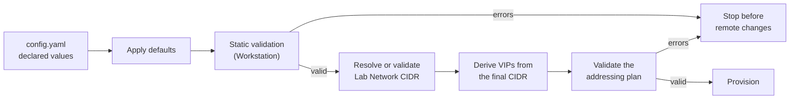

# Configuration

`virtlab` is declarative. You describe one lab in one YAML file. The `up`,
`down`, and `status` commands read that file at startup. The file is the
desired state. It is not runtime state. For runtime state, see
[state.md](state.md).

## How the configuration is processed



1. `virtlab` reads and parses the YAML file.
2. `virtlab` fills each absent optional field with its default.
3. `virtlab` runs static validation on the Workstation. An error stops the
   command before any remote change.
4. During `up`, `virtlab` resolves the Lab Network CIDR on the Host. If
   `network.cidr` is set, `virtlab` validates it and checks for conflicts. If
   `network.cidr` is absent, the Host allocates a subnet automatically.
5. `virtlab` derives the VIPs from the final CIDR.
6. `virtlab` validates the complete addressing plan.
7. `virtlab` provisions the lab.

The resolved CIDR and VIPs stay in memory for the current command. `virtlab`
does not write them back to the file. A later command resolves them again.

## File location

| Rule | Behavior |
|---|---|
| Default path | `config.yaml` in the current directory. |
| Custom path | Use `--config <path>` with `up`, `down`, or `status`. |
| Fallback | If the path is the default `config.yaml` and that file is absent, `virtlab` tries `config.local.yaml`. |
| Template | Copy `examples/config.example.yaml` and edit your copy. |
| Version control | `config.yaml` and `*.local.*` files are gitignored. Do not commit them. |

## Schema

The machine-readable schema is in
[config.schema.json](../internal/config/config.schema.json). `virtlab` embeds
this file and validates every configuration it loads against it. Unknown keys,
wrong types, and values that do not match the documented format fail before
any provisioning starts.

Point your editor at the same file to get completion and validation. Editors
that use the YAML Language Server read a comment at the top of the file.
Adjust the path to match the location of your config file:

```yaml
# yaml-language-server: $schema=./internal/config/config.schema.json
```

## Minimal example

```yaml
clusterName: "demo"
ocpVersion: "4.22.0"

hostSsh:
  host: "hypervisor.example.net"
  publicKeyFile: "~/.ssh/id_ed25519.pub"
```

This file uses the defaults: preset `sno`, user `root`, base domain
`example.com`, an allocated Lab Network, and an `ocm`-provided pull secret.

## Complete example

```yaml
clusterName: "demo"
baseDomain: "example.com"
ocpVersion: "4.22.0"
preset: "ha"

hostSsh:
  host: "hypervisor.example.net"
  user: "root"
  publicKeyFile: "~/.ssh/id_ed25519.pub"

pullSecretFile: "~/pull-secret.json"

network:
  name: "demo-net"
  cidr: "192.168.100.0/24"
  # apiVip: "192.168.100.5"
  # ingressVip: "192.168.100.6"
  # ingressLbVip: "192.168.100.7"

controlPlaneOverrides:
  vcpus: 8
  memoryMib: 16384
  diskGib: 200

workerOverrides:
  vcpus: 4
  memoryMib: 8192
  diskGib: 100
```

## Top-level fields

| Key | Type | Required | Default | Description |
|---|---|---|---|---|
| `clusterName` | string | Yes | — | Lab and cluster name. Lower-case RFC 1123 label, 1-32 characters. Must start and end with a letter or digit. |
| `baseDomain` | string | No | `example.com` | Base DNS domain. Must be a valid RFC 1123 domain with at least one dot. The top-level label must not be all numeric. |
| `ocpVersion` | string | Yes | — | OpenShift version in `MAJOR.MINOR.PATCH` form. Supported Y-streams: `4.20`, `4.21`, `4.22`. |
| `preset` | string | No | `sno` | Cluster topology: `sno`, `compact`, or `ha`. |
| `hostSsh` | object | Yes | — | SSH settings for the Host. See [hostSsh](#hostssh). |
| `pullSecretFile` | string | No | — | Path to the OpenShift pull secret. See [Pull secret](#pull-secret). |
| `network` | object | No | — | Lab Network settings. See [network](#network). |
| `controlPlaneOverrides` | object | No | Preset values | Hardware overrides for each Control Plane Node. |
| `workerOverrides` | object | No | Preset values | Hardware overrides for each Worker Node. `ha` only. |

## hostSsh

| Key | Type | Required | Default | Description |
|---|---|---|---|---|
| `host` | string | Yes | — | Hostname or IP address of the Host. The Workstation must reach it over SSH. |
| `user` | string | No | `root` | SSH user on the Host. |
| `publicKeyFile` | string | Yes | — | Path to the SSH public key on the Workstation. `~` expands to the home directory. The file must exist, be non-empty, and contain an OpenSSH public key. |

`virtlab` installs this key on the Host. It also injects the key into the Nodes
for console access.

Changing `host` or `user` for an existing `clusterName` is not supported.
`virtlab` binds the Pulumi stack to the Host that created it and stops with an
error on a change. Tear the lab down on the original Host first, then use the
same `clusterName` on the new Host. The Pulumi state stores and backup
procedure are in [state.md](state.md#backup-and-restore).

## network

| Key | Type | Required | Default | Description |
|---|---|---|---|---|
| `name` | string | No | `<clusterName>-net` | Name of the Lab Network. 1-64 characters. Must start with a letter or digit. |
| `cidr` | string | No | Allocated | IPv4 subnet in CIDR notation. See [Lab Network allocation](#lab-network-allocation). |
| `gatewayIp` | string | No | — | Not permitted. `virtlab` derives the gateway from `cidr`. |
| `apiVip` | string | No | Offset `.5` | API VIP, published as `api` and `api-int`. `compact` and `ha` only. |
| `ingressVip` | string | No | Offset `.6` | Ingress VIP for the cluster's own keepalived. `compact` and `ha` only. |
| `ingressLbVip` | string | No | Offset `.7` | Ingress Load Balancer VIP, the answer for `*.apps`. `compact` and `ha` only. |

Offsets are relative to the network address of the resolved CIDR. For example,
in `192.168.100.0/24`, offset `.5` is `192.168.100.5`.

### Lab Network allocation

If `network.cidr` is absent, `virtlab` probes the Host:

1. If a Lab Network with the same `network.name` already exists, `virtlab`
   reuses its subnet and gateway.
2. Otherwise, `virtlab` selects the lowest free `192.168.X.0/24` subnet,
   starting at `X=100`. The subnet must not overlap with Host routes, Host
   interfaces, or other libvirt networks.

If `network.cidr` is set, `virtlab` validates the value and checks for conflicts
on the Host. An explicit CIDR gives stable VIPs across runs.

### VIP rules

An explicit VIP must obey all of these rules:

- It must be a valid IPv4 address.
- It must be inside `network.cidr`.
- It must not be the network address or the broadcast address.
- It must not be the gateway.
- It must not collide with a Control Plane Node lease or a Worker Node lease.
- It must not be inside the DHCP pool.
- `apiVip`, `ingressVip`, and `ingressLbVip` must be different addresses.

The `sno` preset does not use VIPs. The single Node serves the API and the
application routes. `virtlab` ignores VIP overrides for `sno` and prints a
warning.

If `network.cidr` is absent, `virtlab` validates VIP overrides only after the
Host allocates the subnet. Set `network.cidr` explicitly if you need
deterministic VIP validation.

## Addressing plan

| Address | Default offset | Used by | Present in |
|---|---|---|---|
| Gateway | `.1` | Guest default route and DNS | All presets |
| API VIP | `.5` | `api` and `api-int` | `compact`, `ha` |
| Ingress VIP | `.6` | Reserved by `platform: baremetal` | `compact`, `ha` |
| Ingress LB VIP | `.7` | `*.apps.<clusterName>.<baseDomain>` | `compact`, `ha` |
| Control Plane Node leases | `.10` and up | Node addresses | All presets |
| Worker Node leases | `.20` and up | Node addresses | `ha` |
| DHCP pool | `.100`-`.200` | Hand-attached Guests | All presets |

In `sno`, `api`, `api-int`, and `*.apps` all resolve to the single Node's
lease.

## Presets and sizing

| Preset | Nodes | Default per Node | Total minimum |
|---|---|---|---|
| `sno` | 1 Control Plane Node (schedulable) | 8 vCPU, 16 GiB RAM, 120 GiB disk | 8 vCPU, 16 GiB RAM, 120 GiB disk |
| `compact` | 3 Control Plane Nodes (schedulable) | 4 vCPU, 16 GiB RAM, 100 GiB disk | 12 vCPU, 48 GiB RAM, 300 GiB disk |
| `ha` | 3 Control Plane Nodes + 2 Worker Nodes | Control Plane: 4 vCPU, 16 GiB RAM, 100 GiB disk<br>Worker: 2 vCPU, 8 GiB RAM, 100 GiB disk | 16 vCPU, 64 GiB RAM, 500 GiB disk |

The defaults are the official Red Hat bare-metal minimums. `virtlab` prints a
warning when you set a value below the minimum for the Node role.

## controlPlaneOverrides and workerOverrides

Both objects accept the same keys.

| Key | Type | Required | Default | Description |
|---|---|---|---|---|
| `vcpus` | integer | No | Preset value | Number of vCPUs per Node. |
| `memoryMib` | integer | No | Preset value | RAM per Node in MiB. For example, `16384` is 16 GiB. |
| `diskGib` | integer | No | Preset value | Single root disk size per Node in GiB. Cannot be combined with `disks`. |
| `disks` | list of objects | No | Preset value | Ordered list of disks per Node (`sizeGib` in GiB for each entry). The first entry is the root OS disk (`/dev/vda`); additional entries attach as `/dev/vdb`, `/dev/vdc`, up to 26 disks. Cannot be combined with `diskGib`. |

Use positive integers. An absent field keeps the preset value. An override
applies to every Node in that role.

To attach multiple disks to a Node role (for example, an OS disk plus an
additional data disk for local storage or Ceph), use `disks`:

```yaml
workerOverrides:
  vcpus: 4
  memoryMib: 16384
  disks:
    - sizeGib: 100 # /dev/vda (root OS disk)
    - sizeGib: 200 # /dev/vdb (additional disk)
```

`workerOverrides` applies only to `ha`. In `sno`, `virtlab` ignores the object
and prints a warning. In `compact`, the object has no effect because the preset
has no Worker Nodes.

## Pull secret

The OpenShift installation needs a Red Hat pull secret. Use one of these
methods:

1. Set `pullSecretFile` to the path of a pull secret file on the Workstation.
   The file must be valid JSON with an `auths` section. `~` expands to the home
   directory.
2. Set the `VIRTLAB_OCM_TOKEN` environment variable to a Red Hat offline token
   from <https://console.redhat.com/openshift/token>. `virtlab` uses the token
   exclusively: it does not read an ambient `ocm` session and does not prompt.
   This method works on CI runners and headless hosts.
3. Omit `pullSecretFile` and `VIRTLAB_OCM_TOKEN`, and log in with the `ocm`
   CLI. `virtlab` retrieves the pull secret automatically.

Resolution is deterministic. `pullSecretFile` takes precedence over
`VIRTLAB_OCM_TOKEN`, and the token takes precedence over the ambient `ocm`
session. `VIRTLAB_OCM_TOKEN` is an environment-only input; it is not a
configuration key. `virtlab` never prints the token and never passes it on a
command line.

If neither method works, `virtlab` stops with an error. It never stores the pull
secret in `config.yaml` or in state. Keep the secret file out of version
control.

## Validation

`virtlab` validates the file before any remote change.

### Errors

An error stops the command. `virtlab` reports these errors:

- `clusterName` is absent, longer than 32 characters, or not an RFC 1123 label.
- `baseDomain` is not a valid RFC 1123 domain.
- `ocpVersion` is absent, is not a semantic version, or is outside the supported
  Y-streams.
- `hostSsh.host` is absent.
- `hostSsh.publicKeyFile` is absent, unreadable, empty, or not an OpenSSH public
  key.
- `pullSecretFile` is set but the file does not exist.
- `preset` is not `sno`, `compact`, or `ha`.
- `network.name` is invalid.
- `network.gatewayIp` is set.
- `network.cidr` is invalid or not IPv4.
- A VIP override is invalid or conflicts with another address.
- The Host does not have sufficient RAM or disk for the cluster. This check runs
  during `up`.

### Warnings

A warning does not stop the command. `virtlab` reports these warnings:

- `workerOverrides` is set with the `sno` preset.
- VIP overrides are set with the `sno` preset.
- VIP overrides are set with an allocated CIDR and will be checked later.
- The cluster requests more vCPUs than the Host has physical vCPUs.
- A hardware value is below the Red Hat minimum for the Node role.

`virtlab` prints warnings and continues. After a Host capacity warning, `up`
asks for confirmation. Use `--yes` or `-y` to skip the prompt in unattended
runs.

## Related

- Runtime state: [state.md](state.md).
- Domain vocabulary: [UBIQUITOUS-LANGUAGE.md](UBIQUITOUS-LANGUAGE.md).
- Procedures: [runbooks/bring-up-lab.md](runbooks/bring-up-lab.md) and
  [runbooks/teardown-lab.md](runbooks/teardown-lab.md).
