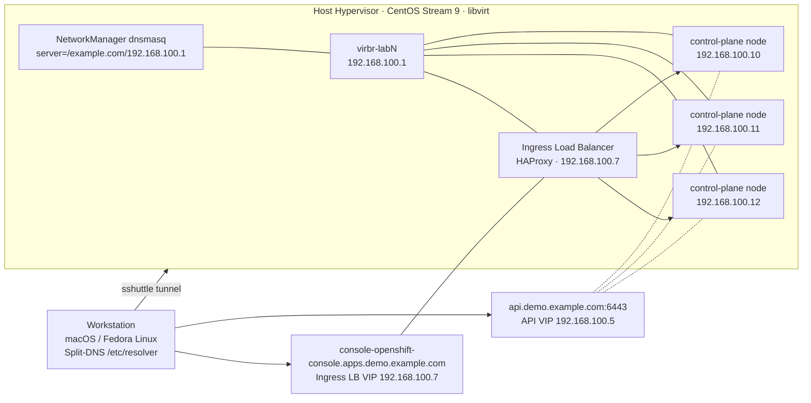

# Lab architecture

Reference material, not a procedure. It explains the topology and what the lab automation
owns; the procedures live in [`../README.md`](../README.md). Formal domain terms are in
[`../../UBIQUITOUS-LANGUAGE.md`](../../UBIQUITOUS-LANGUAGE.md).

```
workstation ──sshuttle (SSH)──▶ host VM (CentOS Stream 9, KVM/libvirt)
                                  │  sshuttle: tunnels 192.168.100.0/24 + DNS
                                  │  demo-net (bridge virbr-lab0, 192.168.100.0/24)
                                  ▼
                                guest demo ── OpenShift 4.22.0
                                  api.demo.example.com:6443
                                  console-openshift-console.apps.demo.example.com
```



The diagram shows `compact`/`ha`. In `sno` there is a single guest, no VIPs and
no HAProxy: `api`/`api-int`/`*.apps` all resolve to that node's lease.

## What the Lab Automation owns

`virtlab up` (or `make up`) creates and reconciles these resources:

| Resource | Domain Package | Key values |
|---|---|---|
| libvirt network | `internal/infrastructure` (`network.go`) | `<cluster>-net`, bridge `virbr-lab0`, CIDR auto-allocated (example `192.168.100.0/24`), gateway `.1`, DNS zone `<baseDomain>`, static leases `master-N` → `.10+`, `worker-N` → `.20+` |
| guest VM + pool + disk | `internal/infrastructure` (`guest.go`, `storagepool.go`) | domains `<cluster>-<node>`, volumes `<cluster>-<node>.qcow2`, pool `<cluster>` at `/home/libvirt/<cluster>/pool`, serial log `/home/libvirt/<cluster>/logs/<node>-serial.log` |
| host DNS bridge | `internal/host` (`prepare.go`) | NetworkManager dnsmasq forwarding zone to libvirt gateway |
| cluster VIPs | `internal/config` (`ResolveVIPs`), `internal/infrastructure` (`network.go`) | `api`/`api-int` → API VIP, `*.apps` → Ingress LB VIP; `platform: baremetal` with `provisioningNetwork: Disabled` for `compact`/`ha`, `platform: none` for `sno` |
| host ingress LB | `internal/host` (`ingresslb.go`), `internal/host/prepare.go` | `haproxy` package, ports `80/tcp` `443/tcp` in the `libvirt` firewalld zone, VIP on the bridge, `/etc/virtlab/<cluster>-haproxy.cfg`, unit `virtlab-<cluster>-haproxy` |
| VRRP readiness | `internal/host` (`multicast.go`) | IGMP snooping written to `0` on the lab bridge so VRRP multicast reaches every guest |
| cluster bootstrap | `internal/cluster` (`openshift.go`) | agent ISO, attach/boot/eject, `install-complete`, `oc` smoke |
| workstation tunnel | `internal/workstation` (`tunnel.go`, `splitdns.go`) | `sshuttle` transparent proxy and targeted split-DNS |

## Manual or External Prerequisites

The host base and initial SSH key authorization are documented:

| Step | Procedure |
|---|---|
| CentOS Stream 9 base, libvirt, NTP, forwarding | [`../prepare-host-vm.md`](../prepare-host-vm.md) |
| Workstation tunnel connectivity | [`../connect-workstation-sshuttle.md`](../connect-workstation-sshuttle.md) |
| SSH key authorization | [`../grant-laptop-host-access.md`](../grant-laptop-host-access.md) |
| OpenShift toolchain and pull secret | [`../install-host-tools.md`](../install-host-tools.md), [`../store-pull-secret.md`](../store-pull-secret.md) |
| Workstation toolchain and split DNS | [`../prepare-laptop.md`](../prepare-laptop.md), [`../configure-laptop-dns.md`](../configure-laptop-dns.md) |

## Source of truth

Values quoted in the procedures are examples only. The authoritative values are
in `config.yaml`; if a document and the code disagree, the code wins and the
document must be fixed in the same commit.

Personal values (SSH keys, passwords) are examples, not requirements — every operator uses their own.
State is local to the operator's Workstation.
