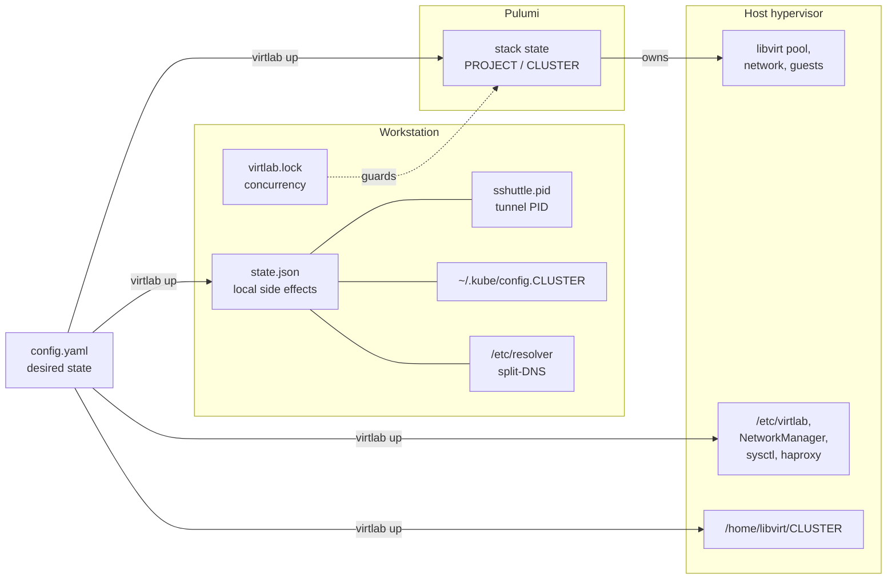

# Application state

This document explains where `virtlab` keeps state, what each store controls,
and the rules that keep the stores consistent.

State is local to your Workstation. `virtlab` has no server-side database. It
uses four storage layers, and each layer has one owner.



## 1. Desired state: `config.yaml`

`config.yaml` is the input. It is not runtime state. `virtlab` reads it at the
start of every command. For file location, schema, defaults, validation, and
network allocation, see [configuration.md](configuration.md).

The network CIDR, gateway, and VIPs are resolved for the current command only.
`virtlab` does not write them back to the file. A later command resolves them
again.

## 2. Infrastructure state: the Pulumi stack

Pulumi is the source of truth for Phase 2 infrastructure. It owns three
resource classes:

| Resource | Created by |
|---|---|
| Lab Pool | `virtlab up` |
| Lab Network and bridge | `virtlab up` |
| Guest VMs and their disks | `virtlab up` |

### Identity

- The Pulumi project is always named `virtlab`.
- The Pulumi stack is named after `clusterName` in `config.yaml`.
- The stack records the Host it was applied to in `libvirt:uri`.
- The stack records the Pulumi backend that owns it in `virtlab:backend`.

Use one `clusterName` for one lab. The stack name is the identity of that lab.
The recorded Host and backend are a safety binding: `virtlab up` and
`virtlab down` stop with an error when `config.yaml` targets a different Host,
or when the active backend changed. `virtlab down` never rewrites
`libvirt:uri`, so it always destroys against the Host that created the
resources.

This binding prevents a lost lab. If the same `clusterName` is pointed at a
second Host, the state is not rewritten and the first Host's resources stay
reachable.

### Where the state is stored

`virtlab` selects a backend in this order:

1. If `PULUMI_BACKEND_URL` or `PULUMI_ACCESS_TOKEN` is set, use it.
2. If Pulumi already has a stored current backend, use it.
3. Otherwise, use a local file backend under your home directory.

The default is local. A cloud backend that you selected on purpose is not
overridden. Do not run bare `pulumi login`. It can switch you to a cloud
backend.

On the first `virtlab up`, the stack records the active backend URL in
`virtlab:backend`. A later command compares the active backend with that
record. If they differ, `virtlab` stops before it reads or writes resources.
Two equivalent local spellings, `file://~` and `file:///home/<user>`, compare
equal.

The local backend keeps state under `~/.pulumi/`:

| Path | Content |
|---|---|
| `~/.pulumi/stacks/<project>/<stack>.json` | Current stack state |
| `~/.pulumi/stacks/<project>/<stack>.json.bak` | Previous stack state |
| `~/.pulumi/history/<project>/<stack>/` | Historical checkpoints |
| `~/.pulumi/locks/` | Stack operation locks |

### State encryption

Pulumi encrypts stack state with a passphrase.

- If `PULUMI_CONFIG_PASSPHRASE` is set, `virtlab` uses it.
- If `PULUMI_CONFIG_PASSPHRASE_FILE` is set, `virtlab` uses that file.
- If neither is set, `virtlab` uses an empty passphrase. This lets unattended
  runs proceed, but it leaves local stack state unencrypted.

Set the passphrase before the first `virtlab up`. If you change it later,
existing stack state becomes unreadable.

### Create, update, and destroy

| Command | Result |
|---|---|
| `virtlab up` | Creates the stack, or reconciles it to the current `config.yaml`. Stops when the stack is bound to another Host or backend. |
| `virtlab down` | Destroys the resources that the stack owns, against the Host recorded in the stack. Stops when the configured Host or active backend does not match the record. |

If the stack does not exist, `virtlab down` treats the infrastructure as
already destroyed. This is not an error. The host and workstation cleanup
stages still run.

A missing or empty stack with live Host resources is an unsafe state.
`virtlab up` stops at the start of Phase 2, because a new stack over existing
VMs creates duplicates. The error prints the recovery choices.

### Backup and restore

The Pulumi stack is the only record of the libvirt resources. Back it up before
a Host change, a backend change, or a Workstation migration.

1. Select the backend that `virtlab` uses and list the stacks:

   ```bash
   export PULUMI_BACKEND_URL="${PULUMI_BACKEND_URL:-file://$HOME}"
   pulumi stack ls --all
   ```

2. Export the stack. For the local file backend, the fully qualified stack
   name is `organization/virtlab/<clusterName>`:

   ```bash
   pulumi stack export \
     --stack organization/virtlab/<clusterName> \
     --file virtlab-<clusterName>.state.json
   ```

   For a cloud backend, use `<organization>/virtlab/<clusterName>`. The export
   stays encrypted with the configured passphrase. Keep the file with that
   passphrase.

3. Restore the export into the same stack:

   ```bash
   pulumi stack import \
     --stack organization/virtlab/<clusterName> \
     --file virtlab-<clusterName>.state.json
   ```

If the stack record is gone from the backend, create it before the import.
`pulumi stack init` needs a Pulumi project, so use a temporary one:

```bash
tmp=$(mktemp -d)
printf 'name: virtlab\nruntime: yaml\n' > "$tmp/Pulumi.yaml"
(cd "$tmp" && pulumi stack init organization/virtlab/<clusterName>)
pulumi stack import \
  --stack organization/virtlab/<clusterName> \
  --file virtlab-<clusterName>.state.json
```

If the CLI cannot reach the backend, the local backend keeps the same record
in `~/.pulumi/stacks/virtlab/<clusterName>.json` and `.json.bak`. Copy both
files only while no `virtlab` command runs. Do not edit them.

After a restore, run `virtlab up` to reconcile. If you cannot restore the
state, run `virtlab down` to remove the leftover VMs and the
`/home/libvirt/<clusterName>` tree. `down` cannot destroy Pulumi-owned pools or
networks without state. Remove a remaining `<clusterName>` pool or
`<clusterName>-net` network with `virsh` before you run `virtlab up` again.

### Re-running `virtlab up`

`virtlab up` is resumable:

- A second run reconciles existing resources. It does not recreate resources
  that already match.
- The capacity check counts the resources of an existing cluster as available
  before it compares free host capacity.
- The OpenShift install has a resume guard. If the installer kubeconfig exists
  and the cluster API answers `healthz` with `ok`, Phase 3 skips the install.

Never edit Pulumi stack state out of band. The stack state is the record that
`virtlab down` uses to destroy resources.

## 3. Workstation state: `state.json`

The Workstation state file records local side effects. It lets `down` reverse
what `up` changed. It is not the source of truth for libvirt resources.

**Path:** `$XDG_STATE_HOME/virtlab/state.json`, or
`~/.local/state/virtlab/state.json` when `XDG_STATE_HOME` is unset.

### Fields

| Field | Meaning |
|---|---|
| `version` | State format version; currently `1` |
| `createdAt` | Time of the first write |
| `updatedAt` | Time of the last write |
| `managedPackages` | Tools that `virtlab` installed, with method and path |
| `clusterName` | Lab recorded as active on this Workstation |
| `baseDomain` | DNS zone used for split-DNS |
| `gatewayIP` | Host gateway used for split-DNS |
| `splitDNSConfigured` | Split-DNS is present |
| `tunnelActive` | The `sshuttle` tunnel was started |
| `tunnelPID` | PID of the tunnel process |

### How `virtlab` reads and writes it

- `virtlab` loads the file at the start of each command.
- A missing file means a clean Workstation. `virtlab` continues without error.
- A corrupt file causes a warning. `virtlab` continues with a clean state. If
  you see this warning, inspect or remove the file before the next command.
- Writes are safe against partial updates. A failed write does not leave a
  half-written file.
- `virtlab` writes the file after tool installs, after split-DNS is configured,
  after the tunnel starts, and after each teardown step.
- When the state is clean, `virtlab down` deletes the file.
- If `virtlab down` cannot load `config.yaml`, it still reverts Workstation
  resources that are recorded in this file.

### Related files in the same directory

| File | Purpose |
|---|---|
| `sshuttle.pid` | PID and start-time fingerprint of the running tunnel; a file whose identity does not verify is treated as stale |
| `virtlab.lock` | Exclusive lock for `up` and `down` |

The lock prevents two `virtlab` commands from running at the same time. A
second command fails with a message that another operation is running.

## 4. Host-side state outside Pulumi

Some Host changes are not Pulumi resources. They are plain files and system
settings. `virtlab` finds them again by `clusterName` convention, not by a
state file.

| Resource | Path or name |
|---|---|
| Cluster tree | `/home/libvirt/<cluster>` |
| Storage pool directory | `/home/libvirt/<cluster>/pool` |
| Installer artifacts | `/home/libvirt/<cluster>/installer` |
| Serial logs | `/home/libvirt/<cluster>/logs` |
| NetworkManager DNS drop-in | `/etc/NetworkManager/conf.d/00-<cluster>-dnsmasq.conf` |
| dnsmasq zone | `/etc/NetworkManager/dnsmasq.d/<cluster>.conf` |
| IPv4 forwarding | `/etc/sysctl.d/99-<cluster>-forward.conf` |
| Ingress LB config | `/etc/virtlab/<cluster>-haproxy.cfg` |
| Ingress LB unit | `/etc/systemd/system/virtlab-<cluster>-haproxy.service` |
| Ingress LB runtime | `/run/virtlab-<cluster>-haproxy.pid` and `.sock` |
| Firewall ports | `80/tcp` and `443/tcp` in the `libvirt` zone |
| Pull secret | `/root/pull-secret.json` |

Guest VMs are matched by the naming pattern
`^<cluster>-(master|worker)-[0-9]+$`. Teardown uses this pattern to keep the
deletion scoped to one lab.

Ownership is strict:

- Pulumi destroys the Lab Pool, Lab Network, Guest VMs, and volumes.
- Host cleanup destroys only leftovers and host-side artifacts. It does not
  delete networks or pools.
- The Ingress Load Balancer is host-owned, not stack-owned. Host cleanup
  removes it on a best-effort basis.
- The pull secret at `/root/pull-secret.json` is a shared prerequisite. Never
  delete it during teardown.

## 5. Workstation credentials

Phase 4 verification writes the cluster access files:

| File | Content |
|---|---|
| `~/.kube/config.<clusterName>` | Synced kubeconfig |
| `~/.kube/kubeadmin-password.<clusterName>` | Kubeadmin password |

`virtlab down` deletes both files, even when an earlier teardown stage failed.

## 6. State ownership rules

1. **One writer per resource.** Do not hand-edit Pulumi state. Do not
   hand-delete libvirt objects during a `virtlab` operation.
2. **Reversibility.** Everything `up` changes, `down` must undo. The
   Workstation state file exists for this purpose.
3. **Concurrency.** Only one `up` or `down` runs at a time. The lock enforces
   this.
4. **Secrets stay out of state.** The pull secret stays on the Host.
5. **State is local.** Do not copy `~/.pulumi`, `state.json`, or kubeconfigs
   between machines while a command runs. Use
   [Backup and restore](#backup-and-restore) to move the Pulumi stack.
6. **`status` reads live state.** It checks the tunnel PID, SSH reachability,
   the kubeconfig files, and `state.json`. It does not read the Pulumi stack.

## Related

- Configuration schema, defaults, and validation:
  [`configuration.md`](configuration.md).
- Domain terms: [`UBIQUITOUS-LANGUAGE.md`](UBIQUITOUS-LANGUAGE.md).
- Procedures: [`runbooks/bring-up-lab.md`](runbooks/bring-up-lab.md),
  [`runbooks/teardown-lab.md`](runbooks/teardown-lab.md),
  [`runbooks/prepare-laptop.md`](runbooks/prepare-laptop.md).
- Architecture and resource ownership: [`architecture.md`](architecture.md).
